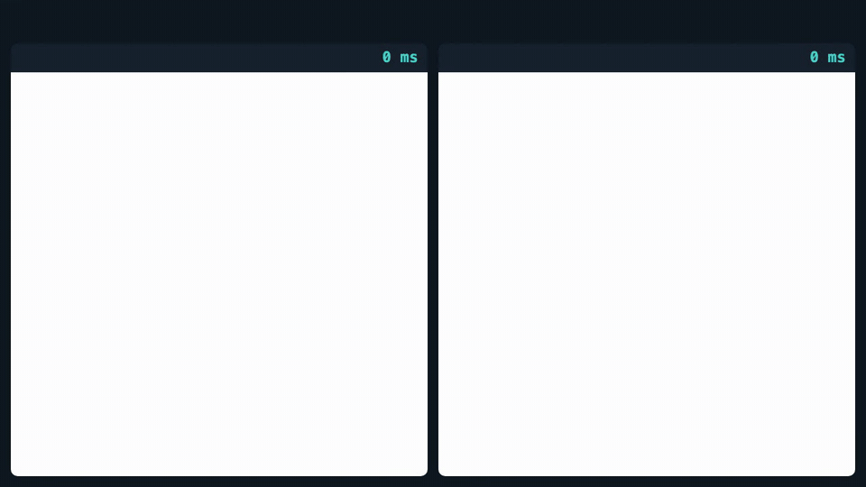
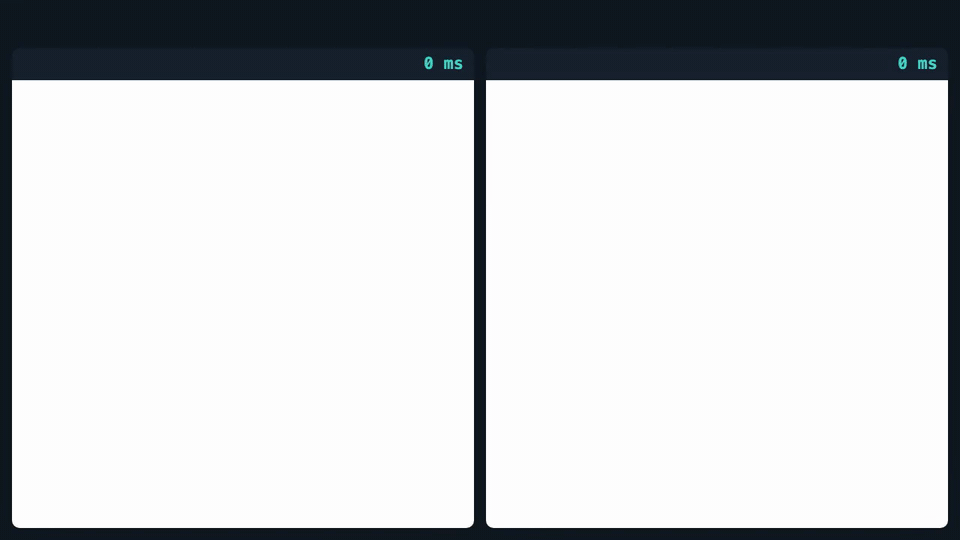

:::message
この記事はAIとの共著です。
:::

こんにちは！[@Ryo54388667](https://x.com/Ryo54388667)です！☺️

普段は都内でエンジニアとして業務をしてます！主にTypeScriptやNext.jsといった技術を触っています。

Lambda Web Functions が出たとき、最初に気になったのは「Next.js の Suspense ストリーミングで、ちゃんと段階表示されるのか」でした。以前 Lambda Web Adapter で試したときは、うまくいかなかったからです。今回は Vercel と並べて実測してみました！

結論から書くと、Web Functions では追加の設定なしでストリーミングが動き、挙動も Vercel とほぼ同じでした。違いが出たのはコールドスタートのときだけです。

:::message
- 検証したすべての条件で、Suspense のページは100%段階的に届いた（失敗0件）
- Next.js の既定値の `compress: true` のままで動いた
- CloudFront を前に置いても、HTTP/2・HTTP/3 でも同じ結果だった
- 画面遷移で取得する RSC（React Server Components）のペイロードも段階的に届いた
- コールドスタート時、Web Functions は TTFB（最初のバイトが届くまでの時間）が約1.2秒になった
- コールドスタート時、Vercel の PPR（Partial Prerendering）のページは TTFB が速いまま、Suspense の中身が約0.64秒遅れた

:::


*左が Web Functions（東京、直接）、右が Vercel（hnd1）。約1秒で Weather、約3秒で Analytics が届く*

計測日は2026年11月21日です。バージョンは Next.js 16.4.6、React 19.3.1、Node.js 24 を使いました。

## 📌 背景

### Lambda Web Functions とは？

Lambda Web Functions は、2026年10月に GA（一般提供）になった Lambda の新しい実行形態です。東京を含む5リージョンで使えます。HTTP サーバーをそのまま Lambda で動かせて、レスポンスのストリーミングにも対応しています。

https://aws.amazon.com/blogs/aws/announcing-aws-lambda-web-functions-for-fast-consistent-web-app-performance-anywhere/

これまで Next.js を Lambda で動かすときは、Lambda Web Adapter を挟むのが定番でした。Web Functions では、`next build` の standalone 出力をほぼそのまま載せられます。

### 以前 Lambda Web Adapter で試したときは段階表示されなかった

以前、Lambda Web Adapter で Next.js の SSR Streaming を試しました。

https://zenn.dev/ryota_09/articles/212902afa784c7

レスポンスには `Transfer-Encoding: chunked` のヘッダーが付いていて、TTFB も速かったのに、Suspense の部分は全部同じタイミングで表示されました😅

Web Functions もストリーミング対応をうたっています。今回は Suspense の段階表示まで動くのか、自分で確かめたくなりました。

### ヘッダーと TTFB では判定できない

前回の件で分かったのは、chunked ヘッダーが付いていても、TTFB が速くても、段階表示されているとは限らないことです。確かめるには、Suspense 境界ごとのチャンクがいつ届いたかを見る必要があります。

既存の記事も探しました。Web Functions に Next.js をデプロイする記事はいくつかありましたが、Suspense のチャンクの到着時刻まで測った記事は、日本語でも英語でも見つかりませんでした。

いちばん近いのは Aiden Vaines 氏の記事です。Amplify と Web Functions に同じ Next.js アプリを載せ、Suspense の中に1.2秒の遅延を仕込んで、Playwright で表示のタイミングを比べています。Web Functions では外側の表示から約1.2秒（1,192ms）後に Suspense 内のパネルが現れ、Amplify では差が約24ms でした。段階表示されていると読める結果です。ただ、チャンクそのものは見ておらず、Web Functions の前に CloudFront も置いていません。

https://dev.to/avaines/aws-news-lambda-web-functions-2dea

そこで今回は、チャンクの到着時刻を3つの方法で測り、判定基準は計測の前に決めておきました。CloudFront 経由と、画面遷移時の RSC、コールドスタートも測っています。

## 📌 検証方法

### 2つのアプリ

性質の違う2つのアプリを使いました。

| | App A（主） | App B（補助） |
|---|---|---|
| 元にしたもの | [nextjs/streaming-demo](https://github.com/nextjs/streaming-demo)（Next.js 公式のストリーミングガイドが計測例に使っているアプリ） | [Lambda Web Adapter の nextjs-response-streaming](https://github.com/aws/aws-lambda-web-adapter/tree/main/examples/nextjs-response-streaming)（Apache-2.0） |
| 描画方式 | `cacheComponents: true`（PPR）。ビルド時に静的なシェルを作り、残りをリクエスト時に描画する | 従来型の動的 SSR。ページ全体をリクエストごとにサーバーで描画する |
| 検証対象のページ | `/suspense-demo`：Weather が1秒、Analytics が3秒で解決 | `/`：Recommended が5秒、Reviews が10秒で解決 |
| 比較用のルート | `/loading-demo`（2秒）、`/api/stream`（200ms×10チャンク）、`/api/html-stream`（1.5秒ごと） | `/control/no-suspense`（Suspense なし） |

App A は公式デモをそのまま使い、`app/` 配下のコードは変えていません。変更したのは次の3つです。

- Next.js を `16.2.0-canary.49` から `16.4.6` に上げた（React も `19.3.1` に）
- `next.config.ts` に `output: "standalone"` を追加した
- Vercel の関数リージョンをそろえるため、`vercel.json` に `{"regions": ["hnd1"]}` を追加した

:::message
`nextjs/streaming-demo` のリポジトリには LICENSE ファイルがありません。そのため、この記事ではコードを転載せず、リンクと差分の説明だけにしています。
:::

App B は Lambda Web Adapter のサンプルを Web Functions 向けに移植しました。元のサンプルは、ページから自分自身の API を `fetch` で呼んでいます。ただ、URL を組み立てる処理が Vercel 上では外部のデモサイトを叩く作りで、Web Functions と条件がそろいません。そこで、同じプロセス内で Route Handler の `GET` を直接呼ぶように変えました。遅延の処理とデータは元のままです。

ほかに、`await connection()` で動的レンダリングを明示し、計測用のマーカーとして `data-probe` 属性を付けました。`/control/no-suspense` は、同じ部品と同じ遅延を Suspense なしで並べたページで、一括で届く例として使います。

### 比較する経路

```html-embed
<style>
.rt{--fg:#1f2937;--muted:#6b7280;--line:#9ca3af;--bd:#d1d5db;--box:#f9fafb;--a1:#d97706;--a2:#2563eb;color:var(--fg);font-family:system-ui,-apple-system,"Hiragino Sans","Noto Sans JP",sans-serif;font-size:14px;line-height:1.4;padding:4px 0 32px}
[data-theme="dark"] .rt{--fg:#e5e7eb;--muted:#9ca3af;--line:#6b7280;--bd:#4b5563;--box:#1f2937;--a1:#f59e0b;--a2:#60a5fa}
.rt *{box-sizing:border-box}
.rt .box{border:1.5px solid var(--bd);border-radius:8px;padding:6px 8px;background:var(--box);text-align:center;font-weight:600;min-width:0}
.rt .box small{display:block;color:var(--muted);font-size:12px;font-weight:400}
.rt .cf{border-color:var(--a2)}
.rt .wf{border-color:var(--a1);border-width:2px}
.rt .g{display:grid;grid-template-columns:110px 1fr 150px;gap:8px 0;align-items:center}
.rt .g>*{min-width:0}
.rt .cl{grid-column:1;grid-row:1/5;align-self:stretch;display:flex;flex-direction:column;justify-content:center}
.rt .r{grid-column:2;display:flex;align-items:center}
.rt .r1{grid-row:1}.rt .r2{grid-row:2}.rt .r3{grid-row:3}.rt .r4{grid-row:4}
.rt .ln{flex:1;min-width:10px;border-top:1.5px solid var(--line)}
.rt .hd{border-top:5px solid transparent;border-bottom:5px solid transparent;border-left:8px solid var(--line)}
.rt .r .box{width:min(190px,62%)}
.rt .o{grid-column:3;align-self:stretch;display:flex;flex-direction:column;justify-content:center}
.rt .g .wf{grid-row:1/4}
.rt .vc{grid-row:4}
.rt .mob{display:none}
@media (max-width:560px){
.rt .g{display:none}
.rt .mob{display:block}
.rt .two{display:grid;grid-template-columns:3fr 2fr;gap:8px}
.rt .two>*{min-width:0}
.rt .grp{display:flex;flex-direction:column;gap:6px;border:1.5px dashed var(--bd);border-radius:10px;padding:6px}
.rt .mid{align-self:center}
.rt .dn{display:flex;flex-direction:column;align-items:center;padding:2px 0}
.rt .dn::before{content:"";height:12px;border-left:1.5px solid var(--line)}
.rt .dn::after{content:"";border-left:5px solid transparent;border-right:5px solid transparent;border-top:8px solid var(--line)}
}
</style>
<div class="rt">
<div class="g">
  <div class="box cl">計測地点<small>自宅</small><small>EC2（東京）</small></div>
  <div class="r r1"><div class="ln"></div><div class="box">直接<small>HTTP/1.1</small></div><div class="ln"></div><div class="hd"></div></div>
  <div class="r r2"><div class="ln"></div><div class="box cf">CloudFront<small>キャッシュ無効・h2 / h3</small></div><div class="ln"></div><div class="hd"></div></div>
  <div class="r r3"><div class="ln"></div><div class="box cf">CloudFront<small>圧縮有効・h2 / h3</small></div><div class="ln"></div><div class="hd"></div></div>
  <div class="r r4"><div class="ln"></div><div class="box">Vercel のドメイン<small>h2</small></div><div class="ln"></div><div class="hd"></div></div>
  <div class="box o wf">Lambda Web Functions<small>ap-northeast-1</small></div>
  <div class="box o vc">Vercel<small>hnd1</small></div>
</div>
<div class="mob">
  <div class="box">計測地点<small>自宅 / EC2（東京）</small></div>
  <div class="two"><div class="dn"></div><div class="dn"></div></div>
  <div class="two">
    <div class="grp">
      <div class="box">直接<small>HTTP/1.1</small></div>
      <div class="box cf">CloudFront<small>キャッシュ無効</small><small>h2 / h3</small></div>
      <div class="box cf">CloudFront<small>圧縮有効</small><small>h2 / h3</small></div>
    </div>
    <div class="box mid">Vercel の<br>ドメイン<small>h2</small></div>
  </div>
  <div class="two"><div class="dn"></div><div class="dn"></div></div>
  <div class="two"><div class="box wf">Lambda Web Functions<small>ap-northeast-1</small></div><div class="box">Vercel<small>hnd1</small></div></div>
</div>
</div>
```

Web Functions は ap-northeast-1 に、`nodejs24.x`（Arm64）でデプロイしました。CloudFront は2通り用意しています。1つはキャッシュポリシーに `CachingDisabled` を使ったもので、以下「キャッシュ無効の CloudFront」と呼びます。もう1つは TTL を 0/0/1 にし、gzip/br をキャッシュキーに含め、Compress を有効にしたもので、以下「圧縮有効の CloudFront」と呼びます。

Vercel は Hobby プランで、`regions: ["hnd1"]` を指定し、Fluid compute は既定のままにしました。Web Functions と同じコミットを `vercel deploy --prod` でデプロイしています。CloudFront と Vercel のカスタムドメインには、検証用に取ったドメインのサブドメインを使いました。

### 3つの計測方法

1つの方法だけで測ると、その方法自体がデータをためていた場合に見分けがつきません。そこで、仕組みの違う3つの方法で測りました。

| 方法 | 仕組み | 判定に使うもの |
|---|---|---|
| Node.js の fetch | `fetch` + `getReader()` で本文を読む。公式ガイドの `stream-observer.mjs` を拡張したもの | マーカー文字列が初めて現れた時刻 |
| curl | `curl --http1.1 --trace-ascii - --trace-time`。JS を介さずにワイヤー上のバイトを見る | チャンクのまとまりが届いた時刻（受信が400ms 以上途切れたら別のまとまりとみなす） |
| ブラウザ（Chromium） | Playwright で Chromium を動かし、CDP の `Network.dataReceived` を記録する。初回表示と、`window.next.router.push` による画面遷移の2通り | チャンクのまとまりが届いた時刻 |

このほか、説明用に Chromium のパフォーマンストレース（DevTools 形式）を20本取りました。

### 判定基準

結果を見てから基準を調整すると、都合のいい結論を出せてしまいます。そのため、閾値は計測の前に決めて、あとから変えていません。

判定に使うのは、シェルが届いてから、1つ目と2つ目の Suspense の中身がそれぞれ届くまでの時間です。シェルを起点にした時間差で見るので、時計のずれやコールドスタートの影響を受けにくくなります。

| | STREAMED（段階的に届いた） | BUFFERED（一括で届いた） |
|---|---|---|
| App A | 1つ目が700ms 以上、2つ目が2,500ms 以上あとに届く | どちらもシェルから300ms 未満で届く |
| App B | 1つ目が4,000ms 以上、2つ目が9,000ms 以上あとに届く | どちらもシェルから500ms 未満で届く |

どちらの条件も満たさないものは PARTIAL、fetch と curl の判定が食い違ったものは INVALID としました。

計測そのものが正しく動いているかの条件も決めています。ストリーミングできると分かっている Vercel（陽性対照）が95%以上 STREAMED になること、Suspense なしのページ（陰性対照）が100% BUFFERED になること、INVALID が5%未満であることの3つです。そのうえで、Web Functions が95%以上 STREAMED なら合格としました。

ウォームスタート時の計測は、条件ごとに30回です（自宅からの CloudFront 計測だけ10回）。条件を順番に入れ替えながら回して、時間帯による偏りを避けました。

### 計測の流れ

1. 公式デモ（`streaming-demo.labs.vercel.dev`）で、ガイドに書かれた出力を再現する（計測方法の確認）
2. ローカルで事前に動作を確かめる（`next start` と、Web Functions 用パッケージを読み取り専用のコンテナで動かしたもの）
3. 直接エンドポイントを計測する（自宅と EC2 から各30回）
4. ブラウザで計測し、代表トレースを取る
5. CloudFront 経由を計測する（EC2 から30回、自宅から10回）
6. コールドスタートを計測する（35分空けて5回）

1では、ガイドに書かれた出力（シェルが +0ms、境界がおおむね +1,000ms と +3,000ms）を fetch と curl の両方で再現できました。2では、fetch と curl の判定が 130/130 で一致しています。計測方法そのものは信用してよさそうです。

## 📌 結果

ひとことで言うと、Web Functions は Vercel と同じように、Suspense の中身を仕込んだ遅延どおりに段階的に届けました。

たとえば App A には、1秒後と3秒後に表示される部品を仕込んでいます。Web Functions では、シェルが届いてからそれぞれ約1.0秒後と約3.0秒後に中身が届き、何度測ってもずれは数ms でした。Vercel との差は20ms ほどで、見た目で分かる差ではありません。CloudFront を挟んでも、ブラウザで画面遷移しても、この結果は変わりませんでした。

違いが出たのはコールドスタートのときです。Web Functions は、最初のバイトが届くまでに約1.2秒かかりました。Vercel の PPR のページは最初のバイトこそ速いものの、Suspense の中身が約0.64秒遅れて届きました。

以下、条件ごとに説明します。細かい数値は折りたたんでいます。

### 直接エンドポイント

EC2（東京）から Web Functions と Vercel に直接アクセスし、条件ごとに30回ずつ測りました。Suspense のページはすべて段階的に届き、Suspense なしのページはすべて約10秒後に一括で届いています。計測方法どうしで判定が食い違うこともありませんでした。

Vercel の App A だけ、中身の到着が約20ms 遅れます。Vercel の PPR では、CDN が静的シェルを先に返し、関数のレスポンスがそのあとに続くからです。

自宅回線から測っても、Suspense のページの結果は同じでした。比較用のルートでまれに PARTIAL が出ましたが、これは自宅回線の揺らぎによるもので、EC2 から測ると0件でした。

:::details 実測値（直接エンドポイント）

EC2（ap-northeast-1）から、条件ごとに30回ずつ計測しました。合計1,440件で、INVALID は0件、fetch と curl の判定は 720/720 で一致しました。

| 対象 | Suspense のページの STREAMED | 1つ目の中身が届くまで（中央値、p10〜p90） | 2つ目の中身が届くまで（中央値） | TTFB（curl） |
|---|--:|---|---|---|
| Web Functions App A | 30/30 × 4条件 | 1,003ms（1,001〜1,004） | 3,004ms | 約21ms |
| Vercel App A | 30/30 × 4条件 | 1,021ms（1,009〜1,028） | 3,021ms | 約18ms |
| Web Functions App B | 30/30 × 4条件 | 5,002ms | 10,001ms | 約23ms |
| Vercel App B | 30/30 × 4条件 | 4,997ms | 9,988ms | 約34〜41ms |

4条件は、圧縮なしと gzip、fetch と curl の組み合わせです。

比較用のルート（`/loading-demo`、`/api/stream`、`/api/html-stream`）も、両プラットフォームで 30/30 が STREAMED でした。Suspense なしのページは、どちらも 30/30 が BUFFERED です。

代表トレースを並べると、Vercel の PPR で到着が遅れる理由が分かります。

```text
Web Functions（直接、初回表示）
  +4.7ms      13,176B   シェル（fallback 入りの HTML）
  +994.8ms     2,997B   Weather の中身
  +3,011.2ms   2,776B   Analytics の中身

Vercel（*.vercel.app、初回表示）
  +2.1ms       3,740B   CDN が返す静的シェル
  +104.6ms     9,436B   関数からの続き
  +1,028.1ms   1,345B   Weather の中身
  +1,039.2ms   1,652B
  +3,029.3ms   2,776B   Analytics の中身
```

Web Functions ではシェルとその続きが1つのチャンク（13,176B）で届いていますが、Vercel では CDN からの 3,740B と関数からの 9,436B に分かれています。

自宅回線からの計測では、時間間隔の判定が厳しい比較用のルートでだけ PARTIAL が出ました（`/api/stream` を curl で測ったときに最大5/30）。受信が数百ms 止まってから、チャンクがまとめて届く形です。Web Functions と Vercel の両方で同じ形が出ていました。

:::

### CloudFront 経由

CloudFront を挟んでも、Suspense の中身が届くタイミングは直接アクセスしたときと変わりませんでした。CloudFront はチャンクをためずに、そのまま流しています。変わったのは最初のバイトが届くまでの時間で、10〜40ms ほど増えました。

:::details 実測値（CloudFront 経由）

EC2 から条件ごとに30回、合計2,160件を計測しました。fetch と curl の判定は 1,079/1,080 で一致しています。Suspense のページは、2種類の CloudFront と Vercel のカスタムドメインのどの組み合わせでも 30/30 が STREAMED、Suspense なしのページは 30/30 が BUFFERED でした。

| 経路 | App A の1つ目 / 2つ目の中身が届くまで（EC2 から curl、圧縮なし） | TTFB（curl、中央値） |
|---|---|---|
| キャッシュ無効の CloudFront → Web Functions | 1,002 / 3,005ms | 27〜67ms |
| 圧縮有効の CloudFront → Web Functions | 1,002 / 3,005ms | 33〜40ms |
| Vercel のカスタムドメイン | 1,027 / 3,027ms | 15〜53ms |
| （参考）Web Functions 直接 | 1,003 / 3,004ms | 約20〜23ms |

自宅からの CloudFront 計測（各10回）でも、Suspense のページはすべて 10/10 が STREAMED です。

:::

### ブラウザ：初回表示と画面遷移の RSC

Chromium で測っても、すべて段階的に届きました。`router.push` で画面遷移したときに取得する RSC のペイロードも同じです。CloudFront 経由では、2回目以降の接続が Alt-Svc で HTTP/3 に切り替わりましたが、結果は変わりませんでした。

:::details 実測値（ブラウザ）

自宅から Chromium で、10対象 × 2シナリオ × 10回、合計200件を計測しました。200/200 が STREAMED で、エラーは0件です。

| 経路 | プロトコル | 初回表示（HTML） | 画面遷移（RSC、`text/x-component`） |
|---|---|---|---|
| Web Functions 直接 | http/1.1 | 10/10（1つ目 1,000ms / 2つ目 3,001ms） | 10/10（1,000 / 3,001ms） |
| CloudFront（2種類とも） | 初回 h2、遷移 h3 | 10/10 | 10/10 |
| Vercel（`*.vercel.app` とカスタムドメイン） | h2 | 10/10 | 10/10 |

数値は App A のものです。App B も全件 STREAMED で、Suspense の中身はシェルから約5,000ms 後と約10,000ms 後に届きました。

:::

### コールドスタート

35分アクセスしない時間を空けてから測ると、どの環境でも段階表示はそのままでしたが、遅れ方に違いが出ました。

Web Functions は、最初のバイトが届くまでに約1.2秒かかります。静的シェルを先に返す CDN がないので、PPR のページでもコールドスタートの時間がそのまま TTFB に出ます。

Vercel の PPR のページは、CDN がシェルをすぐ返すので TTFB は速いままです。その代わり、Suspense の中身は約0.64秒遅れて届きます。TTFB だけを見ていると、この遅れは見落とします。Vercel の動的 SSR のページは、TTFB が約0.8秒伸びました。

:::details 実測値（コールドスタート）

各回の前に35分アクセスしない時間を作り、自宅から5回ずつ計測しました（fetch、圧縮なし）。CloudWatch Logs を見ると、5回とも計測の直前に `wf-init` が出ていて、毎回新しい環境が起動していたことを確認できます。20/20 が STREAMED でした。

| 対象 | 最初のバイトまで（中央値、p10〜p90） | 1つ目の中身が届くまで | コールドスタートの影響 |
|---|---|---|---|
| Web Functions App A | 1,234ms（1,117〜1,322） | 1,018ms | TTFB が約1.1秒伸びる。ストリーミングは正常 |
| Web Functions App B | 1,176ms（1,008〜1,343） | 5,014ms | 同上 |
| Vercel App A（PPR） | 152ms（105〜156） | 1,658ms | シェルは CDN からすぐ返る。Suspense の中身が関数の起動を待ち、ウォームスタート時より約640ms 遅れる |
| Vercel App B（動的 SSR） | 899ms（813〜937） | 4,934ms | TTFB が約0.8秒伸びる |

EC2 からの CloudFront 計測の後半にも、コールドスタートのデータが偶然取れていました。自宅からの計測が終わってアクセスが約7分おきになり、各ラウンドの最初のリクエストがコールドスタートに当たっていたためです。傾向は同じでした。

- CloudFront 経由の Web Functions：TTFB が約0.9〜1.3秒
- Vercel のカスタムドメインの App B：TTFB が約0.72〜0.84秒
- Vercel のカスタムドメインの App A：TTFB は速いまま、1つ目の Suspense の中身が約600ms 遅れて届く

:::

### Suspense の有無の比較

Suspense の有無で見た目がどれだけ変わるかも録画しました。同じ Web Functions 上の App B で、同じ部品・同じ遅延（5秒・10秒）のページを並べています。


*左が Suspense あり（シェルを即表示し、5秒・10秒で差し込み）、右が Suspense なし（10秒間真っ白のあと一括表示）*

## 📌 まとめ

今回の検証で分かったことです。

- **追加の設定なしで動く**: Web Functions では、検証したすべての条件で Suspense のページが100%段階的に届いた
- **Vercel とほぼ同じ挙動**: Suspense 境界の中身は、仕込んだ遅延から数ms の差で届いた
- **CloudFront を挟んでも同じ**: Suspense の中身が届くタイミングは変わらず、TTFB が10〜40ms ほど増えただけ。h2/h3 でも段階的に届いた
- **画面遷移の RSC も段階的に届く**: `router.push` で遷移したときのペイロードも同じだった
- **違いはコールドスタート**: Web Functions は TTFB が約1.2秒になり、Vercel の PPR は TTFB が速いまま Suspense の中身が遅れた
- **判定は到着時刻で見る**: chunked ヘッダーや TTFB だけでは、段階表示されているかは分からない

以前 Lambda Web Adapter で段階表示されずに悩んだので、Web Functions であっさり動いたのはうれしかったです🎉

Web Functions で Next.js を動かそうとしている方の参考になれば幸いです！

最後まで読んでいただきありがとうございます！

気ままにつぶやいているので、気軽にフォローをお願いします！🥺

### おまけ：Web Functions へのデプロイ手順

今回の検証で使ったデプロイ手順です。参考までに載せておきます。

:::details デプロイの手順とハマりどころ

**1. エントリーファイルを用意する**

Web Functions は、待ち受けるアドレスを環境変数 `AWS_LAMBDA_HTTP_ENDPOINT`（`host:port` 形式）で渡してきます。一方、Next.js の standalone の `server.js` は `HOSTNAME` と `PORT` を読みます。そこで、変換するだけの `index.js` を zip のルートに置きます。

```js:index.js
// Lambda Web Functions のエントリー（zip のルートに置く）
// AWS_LAMBDA_HTTP_ENDPOINT（"host:port"）を、standalone の server.js が読む HOSTNAME / PORT に変換する
const fs = require('node:fs');

const [host, port] = (process.env.AWS_LAMBDA_HTTP_ENDPOINT || '127.0.0.1:3000').split(':');
process.env.HOSTNAME = host;
process.env.PORT = port;

// Lambda Web Adapter のサンプルと同じく、.next/cache は /tmp/cache への symlink にしている
fs.mkdirSync('/tmp/cache', { recursive: true });

// 診断用：コールドスタートをログで見分けるため
console.log(JSON.stringify({ event: 'wf-init', t: Date.now(), host, port }));

require('./server.js');
```

最後の `wf-init` のログは、あとでコールドスタートを確かめるのに使いました。

**2. arm64 の Node.js 24 コンテナでビルドする**

Web Functions は Arm64 のみなので、ビルドも `linux/arm64` の `node:24` コンテナで行いました。ビルドスクリプトの主な部分を抜き出すと、次のようになります。

```bash:build-wf.sh（抜粋）
docker run --rm --platform linux/arm64 \
  -v "$SRC":/src:ro -v "$OUT":/out \
  -w /work node:24 bash -euo pipefail -c '
    tar -C /src --exclude=./node_modules --exclude=./.next -cf - . | tar -xf -
    npm i -g pnpm@10.27.0
    # hoisted にして、standalone の出力に pnpm の symlink が残らないようにする
    pnpm install --frozen-lockfile --config.node-linker=hoisted
    pnpm build
    mkdir -p /out/app
    cp -RL .next/standalone/. /out/app/        # -L で残った symlink も実体にする
    cp -R .next/static /out/app/.next/static   # standalone はこの2つをコピーしない
    [ -d public ] && cp -R public /out/app/public
  '
cp wf/index.js "$OUT/app/index.js"
```

pnpm を `node-linker=hoisted` にしているのは、standalone の出力に pnpm の symlink を残さないためです。`.next/static` と `public` は standalone に含まれないので、手でコピーしています。

ローカルでは、読み取り専用のルートファイルシステムを模して動作を確かめました。

```bash
docker run --rm --platform linux/arm64 --read-only --tmpfs /tmp:size=512m \
  -p 3201:8080 -e AWS_LAMBDA_HTTP_ENDPOINT=0.0.0.0:8080 \
  -v "$PWD/dist/app-a-streaming-demo/app":/var/task:ro -w /var/task \
  node:24 node index.js
```

**3. `aws lambda-web deploy` でデプロイする**

```bash
aws lambda-web deploy \
  --name <関数名> \
  --code <パッケージのディレクトリ> \
  --entry-point index.js \
  --create \
  --timeout-seconds 60 \
  --endpoint-type HomeRegion \
  --auth-type ApplicationManaged \
  --max-environments 2 \
  --rate-limit 100
```

デプロイが終わると、`https://<エンドポイントのID>.<…>.on.aws` の形の直接エンドポイントが発行され、そこからページが返ってきます。

**4. ハマりどころ**

- `lambda-web` コマンドは、それを含む AWS CLI v2 でないと使えません。`aws lambda-web help` で確認できます。今回は v2.41.2 を使いました
- `--rate-limit` に指定できるのは、0、100、200 のような100刻みの値だけです
- CLI は symlink をパッケージに含めません。`.next/cache → /tmp/cache` の symlink が入りませんでした。今回のアプリは画像の最適化も ISR も使わないので、HTML のストリーミングには影響していません
- `.next/` のようにドットで始まるディレクトリも、既定でパッケージに含まれます
- 直接エンドポイントは HTTP/1.1 だけです。カスタムドメイン、h2/h3、WAF を使うなら、CloudFront を前に置きます
- CloudFront のオリジンリクエストポリシーは `AllViewerExceptHostHeader` にします。Host ヘッダーを転送すると 404 になりました
- 止めるときは、削除しなくてもエンドポイントの `rateLimit` を0にすれば、503（`Platform.EndpointDisabled`）を返すようになります

停止と再開のコマンドは次のとおりです。

```bash
# 停止
aws lambda-web update-web-function-endpoint --function-name <関数名> \
  --endpoint-name <エンドポイント名> --throttle-config rateLimit=0

# 再開
aws lambda-web update-web-function-endpoint --function-name <関数名> \
  --endpoint-name <エンドポイント名> --throttle-config '{}'
```

:::

### 参考資料

:::details 参考にした資料の一覧

- [Announcing AWS Lambda Web Functions（AWS News Blog）](https://aws.amazon.com/blogs/aws/announcing-aws-lambda-web-functions-for-fast-consistent-web-app-performance-anywhere/)
- [AWS Lambda Web Functions（ドキュメント）](https://docs.aws.amazon.com/lambda/latest/dg/web-functions.html)
- [Testing Lambda Web Functions](https://docs.aws.amazon.com/lambda/latest/dg/web-functions-testing.html)
- [Configuring networking for Web Functions](https://docs.aws.amazon.com/lambda/latest/dg/web-functions-networking.html)
- [Configuring Web Functions](https://docs.aws.amazon.com/lambda/latest/dg/web-functions-configuration.html)
- [Next.js Streaming ガイド](https://nextjs.org/docs/app/guides/streaming)
- [Next.js Self-hosting ガイド](https://nextjs.org/docs/app/guides/self-hosting)
- [nextjs/streaming-demo](https://github.com/nextjs/streaming-demo)
- [aws-lambda-web-adapter / examples/nextjs-response-streaming](https://github.com/aws/aws-lambda-web-adapter/tree/main/examples/nextjs-response-streaming)
- [Vercel Streaming Functions](https://vercel.com/docs/functions/streaming-functions)
- [Lambda Web Functions で Next.js を動かす（クラスメソッド）](https://dev.classmethod.jp/articles/nextjs-on-lambda-web-functions/)
- [Lambda Web Functions で Next.js をホストする（Zenn）](https://zenn.dev/tosuri13/articles/64f17d8c75e147)
- [Lambda Web Functions と Lambda Web Adapter の配信性能比較（クラスメソッド）](https://dev.classmethod.jp/ja/articles/lambda-web-functions-vs-lwa-nextjs-assets/)
- [AWS 上でサーバレスにストリーミング（microCMS）](https://zenn.dev/microcms/articles/aws-serverless-http-response-streaming)

:::
